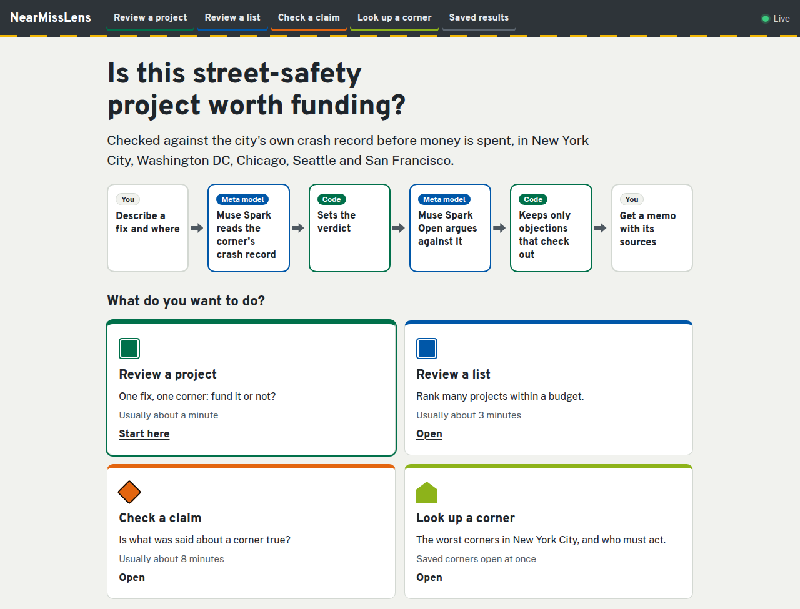
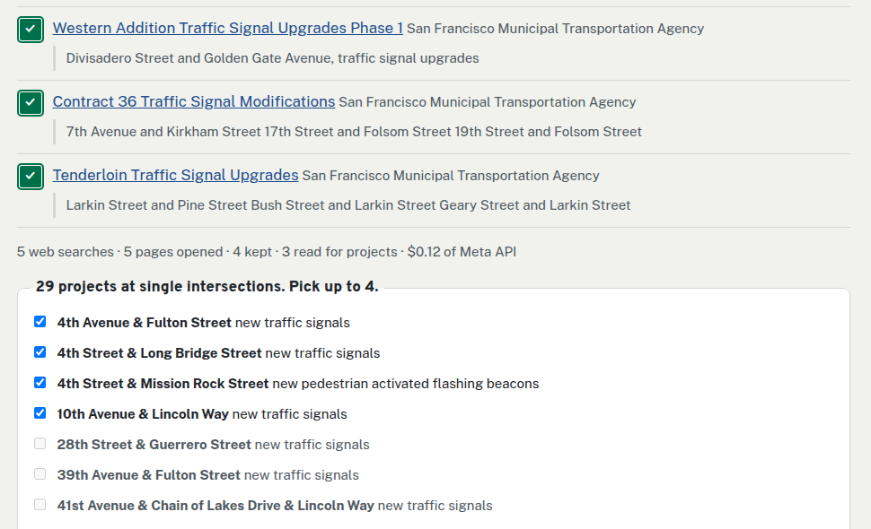

# NearMissLens

[](https://github.com/Morningstaaar36/nearmisslens/actions/workflows/tests.yml)
version 1.0.1 · [changelog](CHANGELOG.md) · Apache-2.0

**Check a street-safety project against the city's own crash record before the money is spent.**

[**Use it live**](https://hussainshahraz720--nearmisslens-copilot-web.us-east.modal.run) (no account, key or install) ·
[Saved results](https://morningstaaar36.github.io/nearmisslens/) · [Test it yourself](TESTING.md) ·
[The evidence in full](EVIDENCE.md)



## Why it matters

Cities choose intersection fixes (new signals, leading pedestrian intervals, beacons) from lists that are often drawn
up before anyone has checked that corner's record. NearMissLens makes that check for one proposal in about 80 seconds,
for about 8 cents of model calls (the averages of the registered run, T28). It answers four questions: are the crashes
there the kind this fix prevents, is the fix already installed, did the city's own past program of this fix work, and
would another fix avoid more?

Two things it found in real proposals:
- A neighborhood commission in Washington DC asked for a leading pedestrian interval at 22nd St & L St NW. DC's own
  signal records show one is already installed.
- NYC DOT proposed intervals at three Lafayette Street corners. New York's signal dataset shows one installed at
  Prince Street since October 2024.

It is for traffic engineers and agencies weighing a project, for community boards and advocates asking for one, and
for reporters checking what an official said about a corner.

## What you can do with it

| Task | You give it | You get back | Usually |
|---|---|---|---|
| **Review a project** | one fix at one intersection, with its cost if known, or one the agency plans that Muse Spark finds on the web | a verdict (proceed, proceed after a site check, compare first, not covered by the evidence, reconsider), its reasons, and a pre-mortem written by a second model | about a minute |
| **Review a list** | several proposals, or the agency's own project pages, found by Muse Spark with web search | each one reviewed, then ranked by code by what the evidence supports, within your budget | a few minutes |
| **Check a claim** | a news link or an official's statement about a corner | which numbers hold, which differ, and which the record cannot test, with every quote checked on its page | about 8 minutes |
| **Look up a corner** | an intersection | what its crashes have in common, what the city already tried, which fix the record supports, who must act, what has been published about it, and a drafted request letter | at once for saved corners |


## How it uses Meta's models

**Meta's models do the research; code sets the verdict.** Nothing is shown until code has checked every number against
the record and every quote against its page. Those checks catch wrong numbers and misquotes, not every wrong
conclusion (see [Limits](#limits)).

| Model | Its job | What checks it |
|---|---|---|
| **Muse Spark 1.3** (Meta Model API) | runs the desk: searches the web, reads pages, investigates the corner, writes the memo; finds an agency's project pages and reads them into project lists | the finish gate: every number against its receipt, every quote against its page |
| **Muse Spark Open** (Baseten) | the red team's pre-mortem against the verdict; request letters; answers about a corner | each objection must name a receipt field and value; every number in a letter is checked |
| **Muse Voice Transcribe** | a spoken proposal from the site (`nml review --audio`) | the transcript goes through the same review |
| **SAM 3.1** | counts people and cars in Seattle's traffic-camera frames (Corner Watch; command line only, `nml cameras`) | agreement between image and video modes |

```
a city      ──▶ Muse Spark 1.3 + web_search finds the agency's project pages ─▶ code opens each page: passage on it word for word
your input ──▶ Muse Spark 1.3 (Meta Model API) works the case with checked tools
                 ├─ web_search, read_page        find and read the source        ─▶ quote must be on the page
                 ├─ tool search over the registry the city's open datasets
                 ├─ investigate                   crash records, past programs,   ─▶ receipts R1, R2, …
                 │                                federal crash-reduction studies,
                 │                                road owners
                 └─ check_claim                   a number against its receipt
             ──▶ code sets the verdict (never the model)
             ──▶ Muse Spark Open (Baseten) argues against it ─▶ code keeps an objection only if its fact checks out
             ──▶ the memo must answer every kept objection   ─▶ finish gate: numbers, quotes, wording
```

The causal gate decides whether a city program reduced crashes. It is a comparison-group before/after with a
placebo date, and neither the model nor an engineer can override it. It is described in [EVIDENCE.md](EVIDENCE.md#the-causal-gate)
and [`docs/METHOD.md`](docs/METHOD.md).

## Cities

It covers **New York, Washington DC, Chicago, Seattle and San Francisco**, the cities that publish geocoded crash
records. Cities are data, not code: each is an entry in [`registry.json`](nearmisslens/data/registry.json), and
`nml cities` lists what each one has. What a city publishes decides what the tool can say there:

| City | Crash records | Past safety programs | Road owners | Saved corners to browse |
|---|---|---|---|---|
| New York City | yes, with per-vehicle detail | yes | from the state's road inventory | 303 |
| Washington DC | yes | yes | presumed city; state routes flagged to confirm | 50 |
| Seattle | yes | yes | presumed city; state routes flagged to confirm | 50 |
| San Francisco | yes | yes | presumed city; state routes flagged to confirm | 50 |
| Chicago | yes | not published | presumed city; state routes flagged to confirm | none yet (reviews and checks work) |



## Results at a glance

Every test was registered before it ran ([`validation/BENCH_PREREG.md`](validation/BENCH_PREREG.md)), and failures are
reported next to successes. The terms used below:

- **T-numbers** (T21c, T32, …) are the ids of those registrations, each with the rule it had to meet.
- **The desk** is Muse Spark's tool loop that works a case.
- **Receipts** (R1, R2, …) are the saved tool results a finding cites.
- **The finish gate** is the code check a case must pass; only then is it **published**.

| What was tested | Result | Rule |
|---|---|---|
| The desk on 36 fresh real cases from the live web (T21c–T21e) | 33 published; **72 of 72** quotes found on the page they cite; $0.063–$0.126 a case | met |
| Muse Spark alone, same inputs, same web search (T24) | **26 of 73** of its quotes from readable pages are not on those pages | baseline |
| `nml check` on 12 inputs nobody chose (T25) | 10 of 10 real inputs published, 26 of 26 quotes verified, both controls caught | met |
| Review a project: 7 real proposals from 5 cities' plans (T26–T28) | 7 of 7 memos, all on the proposed corner; **32 objections** survived the fact check (13 before the rework) | met |
| Review a list: 3 real agency programs (T29b) | 21 of 23 reviewed, each on its own corner; the ranking rebuilt exactly; $0.079 a proposal | met |
| Read an agency's web page into projects (T30c) | **16 of 16** hand-collected projects found, 55 kept; $0.063 a page | met |
| The causal gate on New York's leading pedestrian intervals (T11) | **−17%** pedestrian injury crashes (95% interval −22% to −11%); a naive before/after says −24% | passed |
| A corner's own crash count against an independent count (T32, after T31b's lessons) | agrees at 7 of 10 fresh corners (3 in T31b); mean error 3.9 crashes, against 40.5 when every crash within 100 m is counted | **not met** (8 needed) |
| A frozen patch against a held-out attacker (T18) | cut accepted false claims by 46%, short of the 50% registered | **not met** |

The full story, with what each review of the results still found wrong, is in [EVIDENCE.md](EVIDENCE.md).

**Real cases run live on 4 November 2026**, each written up with its proof and checked by hand against the city's own
data. Each write-up lists the faults the run exposed and the commit that fixed each one, with a test.
- [NYC DOT's leading pedestrian intervals on Lafayette Street](validation/case_studies/2026-11-04_nyc_lafayette/): one is
  already installed at Prince Street (confirmed against NYC's dataset); "compare first" at Great Jones Street;
  "proceed after a site check" at Houston Street. The run also exposed a 2023 death that the New York mapping missed.
- [SDOT's new signal at Dexter Ave N & John St, Seattle](validation/case_studies/2026-11-04_seattle_dexter_john/).
- [The all-way stop Chicago's council ordered at W 41st St & S Albany Ave](validation/case_studies/2026-11-04_chicago_41st_albany/):
  the record holds one injury crash in five years, as the city's data confirms by address.
- [SFMTA's planned signal projects](validation/case_studies/2026-11-04_sf_signal_contracts/), found on the web by Muse Spark.

**Independent testing.** Independent agents (separate AI sessions that had seen only [TESTING.md](TESTING.md)) tested
and audited the product. Their reports are kept as written in [`validation/independent/`](validation/independent/),
with what we changed after each.

## Run it yourself

No key needed (Python 3.12 and [uv](https://docs.astral.sh/uv/)):

```bash
git clone https://github.com/Morningstaaar36/nearmisslens && cd nearmisslens
uv sync
uv run nml --replay engineer "Bruckner Boulevard & Hunts Point Avenue, Bronx, NY"   # a corner's case, offline
uv run nml app                                                 # the page on http://127.0.0.1:8770 (--port N); saved results open
uv run pytest -q                                               # the test suite
```

The first command computes the corner's case from the city's raw police crash records, not from a saved answer. The
public-data responses it reads ship in [`replay/`](replay/) (0.6 MB, built by `nml --replay pack-cache --starter`), so it
runs on a fresh clone. Without `--replay`, any other corner's records are fetched live (free, needs network).

With a Meta Model API key (paid calls, each cached and logged):

```bash
echo "MODEL_API_KEY=..." > .env && set -a && . ./.env && set +a   # BASETEN_API_KEY too, for Muse Spark Open
uv run nml review "Leading pedestrian intervals at Broadway & W 96th St, about \$15,000" --city nyc
uv run nml find sf                                             # the agency's planned projects, found on the web
uv run nml portfolio --from-url URL --city sf --budget-total 500000   # a whole program from the agency's page
uv run nml check "https://a-news-site.example/story" --city dc        # what a news story says, against the record
```

`--replay` serves cached answers only, with records pinned to `validation/ASOF`. [TESTING.md](TESTING.md) walks a
tester through each task and what counts as a failure.

## Running it for others

The live page runs on Modal (`nearmisslens/modal_web.py`) as one small container that scales to zero when idle:
- a **daily model budget** shared by every visitor (the page shows what is left and when it resets), and a request cap
  for new corners;
- a **per-visitor limit** of 10 paid jobs an hour, kept as a salted hash in memory only, never written;
- `GET /health` for an uptime monitor, security headers, and CORS only for the GitHub Pages copy;
- no account, cookies, analytics or request log ([PRIVACY.md](PRIVACY.md));
- a beta notice on every page: it is a screening aid, not engineering advice.

`modal deploy nearmisslens/modal_web.py` deploys it after `modal secret create nearmisslens-keys MODEL_API_KEY=… BASETEN_API_KEY=…`.

## Where things are

| Path | What it holds |
|---|---|
| `nearmisslens/review.py`, `portfolio.py`, `finder.py`, `intake.py`, `check.py` | the four tasks: review a project, review a list, find and read an agency's pages, check a claim |
| `nearmisslens/orchestrator.py`, `agent.py`, `meta_client.py` | the desk: Muse Spark's tool loop, the finish gate and the Meta API client |
| `nearmisslens/engineer.py`, `brief.py`, `opendata.py`, `context.py`, `rootcause.py`, `jurisdiction.py`, `harm.py` | the checked tools: geocoding, crash records, patterns, fixes, road owners, costs |
| `nearmisslens/treatments.py`, `falsify.py` | the causal gate |
| `nearmisslens/app.py`, `budget.py`, `jobs.py`, `modal_web.py`, `web/` | the server, its limits and the page |
| `nearmisslens/data/registry.json`, `fhwa_psc.json` | cities as data; the federal fixes and the limits of each study |
| `validation/` | registered rules, results, independent reports, the proposals test set, the live case studies |
| `replay/` | the public-data answers the no-key example reads, so it runs on a fresh clone |
| `docs/` | the static copy of the page on GitHub Pages, its saved results, and the method |
| `tests/` | the test suite, including ones that tie every number above to its result file and fail on any place name in the product code |
| other modules | research that did not make the product (drone-video tracking, aerial-photo reading, mechanism mining); kept because [BENCH.md](validation/BENCH.md) reports them |

## Limits

- **A screening aid, not a design.** Estimates use the Highway Safety Manual's simple method, one fix at a time, and a
  qualified engineer must review each one.
- **The gates check numbers, quotes and wording, not whether a finding is the right one to make.** An independent
  agent's audit of 12 published desk cases found an error in 7. In 4 of them, the letter said no one was killed where
  people had died. The causes are fixed; no person has audited the cases yet.
- **Whose crashes a corner's counts are** depends on rules the open data does not settle where a city places
  crashes by a point only (T32: 7 of 10, not met).
- **The crash record lags the news** by days to weeks; every answer states the date its records run to.
- **US cities only so far**: the method needs geocoded crash records, which most countries do not publish.

All the limits are in [EVIDENCE.md](EVIDENCE.md#limits).

## Built during the hackathon

Meta Global AI Developer Hackathon, Indie track, "Push the Frontier". Solo entry by Morningstaaar36.

- **Built during the event (Oct 27 – Nov 4, 2026):** all the code in this repository, the city registry, the tests,
  the registered studies and their results, the page and the live deployment. The first commit, `dc089bf`, is dated
  Oct 27 (ET); the history shows the rest.
- **Not ours, and used under their terms:** Meta's models (through the Meta Model API and Baseten), the cities' open
  data, the FHWA crash-modification studies, OpenStreetMap and the map tiles, and the open-source libraries listed in
  `pyproject.toml`. Each is listed with its licence in [LICENSES.md](LICENSES.md); what is stored about whom is in
  [PRIVACY.md](PRIVACY.md).
