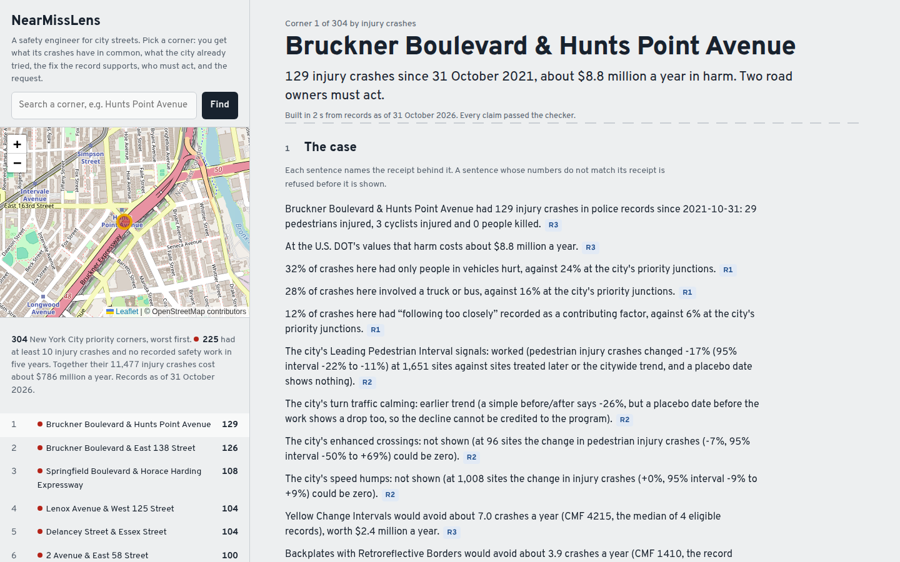

# NearMissLens

**A safety engineer for city streets that has to show its receipts.** Give it a city or a corner. It ranks the worst corners, works out what their crashes have in common, tests what the city already tried against the city's own crash history, ranks fixes by the strength of the evidence behind them, finds which agencies own the roads, and drafts one request per agency. Each claim cites the receipt behind it, and a claim whose numbers do not match that receipt is refused before it is shown.

**Open it:** [morningstaaar36.github.io/nearmisslens](https://morningstaaar36.github.io/nearmisslens/) opens on each city's action plan. It covers New York's 304 Vision Zero priority intersections and the 50 worst crash locations in each of Seattle, Washington DC and San Francisco, found from their own crash records. No key or install is needed.



## The problem

US cities are spending federal safety money on plans like this one. The Safe Streets and Roads for All program has $5 billion for 2022–2026 and has already awarded "$3.9 billion in Federal funding to over 2,000 communities" ([USDOT](https://web.archive.org/web/20261021072608/https://www.transportation.gov/grants/SS4A)). Its 1,272 action-plan grants for FY22–FY25 had a median budget of about $250,000 (our count from USDOT's award lists, [`validation/ss4a/`](validation/ss4a/)). Every eligible plan must map high-risk locations and explain how projects are prioritized: questions 3 and 6 of the self-certification worksheet.

The estimates behind those choices are easy to get wrong in two ways.
- **A fix is credited with an effect measured somewhere else.** FHWA's CMF Clearinghouse warns that "the characteristics associated with the CMF should closely match the characteristics of the scenario at hand" ([FAQ](https://cmfclearinghouse.fhwa.dot.gov/faqs.php)).
- **A program is credited with a drop that was coming anyway.** Before/after comparisons at high-crash sites are "likely to result in an overestimation of the treatment's effect" ([FHWA-RD-94-082](https://www.fhwa.dot.gov/publications/research/safety/humanfac/94082.cfm)).

Requests can also go to the wrong place: at some corners the city is not the only road owner.

NearMissLens drafts the safety analysis and the project list from public records. It is built so that it cannot say more than the record supports.

## What it found

From `nml plan CITY` (validation/results/bench/plan_*.json), records as of 31 October 2026:

| | New York | Seattle | Washington DC | San Francisco |
|---|---|---|---|---|
| Corners | 304 priority intersections | 50 worst | 50 worst | 50 worst |
| Harm a year, each crash counted once (U.S. DOT values) | $786 million | $183 million | $192 million | $129 million |
| Largest low-cost estimate at each corner, added up | 328 crashes a year | 109 | 76 | 58 |
| Supported without a site visit | **84** (80 after regression to the mean), at 123 corners | **74**, at 50 corners | **2**, at 5 corners | **0** |

The gap between the last two rows is the point. In New York the largest estimates mostly need a check nobody has made:
- signal backplates where the record does not show red-light entries;
- yellow timing where nobody knows whether the current interval is short;
- crosswalk studies done at school crossings.

What the evidence supports now is mostly two things:
- **leading pedestrian intervals at 78 corners**, a fix the city's own past installs show working;
- **backplates at 45 corners**, where FHWA's cited study fits.

Seattle's records include road surface, so its wet-road friction estimates qualify. San Francisco's records do not support any low-cost estimate without a site visit.

**New York, also from the same cases:**
- **Who must act.** The city's transportation department is not the only road owner at 12 corners: the state DOT at 11 and a toll authority at 1. Each agency gets its own letter, number-checked like every claim.
- **Programs the record does not back.** 54 corners already got turn calming. Its citywide drop began before the work, so the engineer flags it before the same thing is proposed again.
- **Asked for and turned down.** At 19 corners, a leading pedestrian interval was requested and denied (2004–2016, NYC study requests w76s-c5u4). None is recorded there now, and pedestrians have been injured there since. Ryan E. Kelly found the same 0% approval for these requests in Queens ([2026](https://junipercivic.com/?p=19593)); here each denial is tied to a priority corner and the injuries since.

## One corner: Bruckner Boulevard & Hunts Point Avenue

The worst of the 304:
- **The record.** 129 injury crashes in five years: 29 pedestrians and 3 cyclists injured. That is about $8.8 million a year at the U.S. DOT's values.
- **What the crashes have in common.** A truck or bus was involved in 28% of its 310 police-reported crashes, against 16% at the other priority corners. "Following too closely" was recorded in 12%, against 6%. Both survive a correction for testing many patterns, and the truck share held up on later years the analysis never saw. The corner sits beside the Hunts Point Food Distribution Center; police records cannot say why the share is high.
- **The fix, by evidence.**
  - Reflective signal backplates: about 3.9 fewer injury crashes a year, $1.3 million (CMF 1410, the study FHWA's fact sheet cites).
  - Longer yellow plus all-red time: about 2.0 a year, but only if a timing check shows the current interval is below ITE practice. All four eligible records come from one study (NCHRP Report 705) at signals with short intervals. FHWA's own page cites lower-rated records (380/384, 8–14% fewer crashes), which the code's three-star rule leaves out.
- **Who must act.** The state DOT (Region 11) owns the Bruckner Expressway (I-278) and the Sheridan Boulevard (NY 895), according to the state road inventory. The surface streets are not in that inventory, so they are presumed the city's. Council District 17 and Bronx Community Board 2 can push for the work.
- **What the city's data does not show.** The city's open datasets record no safety work here since a 2015 street project. But New York State's Hunts Point access project improved this intersection in its first phase, completed in 2022 ([announcement](https://www.governor.ny.gov/news/governor-hochul-announces-completion-phase-one-17-billion-hunts-point-access-improvement)). A request to the state should start from that project.

## How it works

The engineer is a Meta model with six tools. Each tool is plain code over public records with a check inside it, and each returns its data with a **receipt**: the datasets it read, the date the records run to, the checks it ran, and the seconds it took.

| Tool | What it reads | The check inside it |
|---|---|---|
| `screen_city` | The city's priority intersections and police crash records | Each crash counted once where junction circles overlap |
| `root_cause` | Crashes within 100 m | A pattern is "over-represented" only after a one-sided binomial test with a Holm correction, at least 10 crashes; the wording is "have in common", never "caused" |
| `test_programs` | Every program a registered study tested in this city, and the projects recorded here | The causal gate (below); a corner that already got a program whose effect was not shown is flagged |
| `choose_fixes` | FHWA Proven Safety Countermeasures and 25 curated CMF Clearinghouse records | A CMF counts only where its study sites match: control, crash group, kind of site, and preconditions; each fix gets an evidence tier (measured here, FHWA-cited, national studies, needs a site check, contradicted here) |
| `who_must_act` | The state road inventory, council and community-board maps | No party without the dataset row behind it; inferred owners are marked |
| `draft_request` | The facts above | Every number in the letter must be the record's value for the words next to it |

The agent finishes by submitting its claims, each citing a receipt. The **finish gate** refuses a claim that:
- cites no receipt;
- uses a number that is not the receipt's value for what the sentence names. For example, "29 pedestrians were killed" when 29 were injured, a program's site count borrowed from another program, or "no crashes at night" when the record has 67;
- uses wording the record cannot support ("caused", "proves", "certain to", "led to");
- states a fix that needs a site check as if it were supported.

`nml engineer "ADDRESS" --agent` lets Muse Spark Open choose the steps and write the claims. Without `--agent` the same tools run in a fixed order with claims written by code; that mode needs no model and builds the site.

## The model proposes, code checks

Every Meta model use is paired with a check it cannot get around, and each pair is measured:

| Meta model | What it does | The check | Result |
|---|---|---|---|
| Muse Spark Open (Baseten) | Writes the case for 35 top corners across 4 cities | Finish gate | 27 run so far: 21 finished with every claim passing, and 29 refused attempts kept, struck through, on the site |
| Muse Spark | Reads each CMF's study record to say where it applies (T19) | The quote must be in the record; scored against hand labels written first | 0.92 accuracy against 0.87 for the structured fields alone; found 4 limits the hand labels missed, now in the data |
| Muse Spark and Muse Spark Open | Attack the finish gate with plausible false claims (T18) | Each attack's spec is checked against the receipt; a patch is frozen before a held-out attacker | The gate as registered let 38% of held-out false claims through; the patched gate 21% (the registered halving was not met) |
| Muse Spark Open | Writes and runs its own analysis code on the city's programs (T12) | Causal gate on held-out sites | Without the gate it missed NYC's LPIs and credited two programs the record does not support; with it, it agreed with the registered studies but passed 5 of 20 fake programs |
| Muse Spark Open | Proposes crash mechanisms from earlier years (T15) | Holm correction, then one test on later years it never saw | False finds near zero; as many distinct mechanisms as an exhaustive grid from 43 times fewer tests, but fewer confirmed (rule not met) |
| Muse Spark Open | Answers free questions about a corner (T17) | Finish gate | With the gate, none of the sentences shown was wrong (by the same checker after the run); 31 without it. The price: 38% of questions got no answer that passed |
| Muse Spark | Finds a new city's crash and program datasets | A validator in the tool | Refused two wrong Seattle mappings; found Seattle's LPI layer, which the gate then measured at −33% |
| Muse Spark + SAM 3.1 | Reads the aerial photo of each corner (T16) | SAM 3.1 must confirm Spark's point; scored against city map layers | No better than always giving the more common answer, so it changes no recommendation |
| SAM 3.1, Muse Image | Tracks road users in drone video; draws the top fix | Conflict measures against reference tracks; SAM checks each drawing | Vehicle recall 0.51–0.97 on unseen flights; 13 of 20 drawings pass |

Results that lost to a simpler method are in [`validation/BENCH.md`](validation/BENCH.md), with the rest.

## The causal gate

The gate decides whether a city program reduced crashes, and neither the engineer nor an AI analyst can override it. The design is the comparison-group before/after (Hauer, 1997). The comparison sites are ones the city treated later, as in staggered difference-in-differences (Callaway & Sant'Anna, 2021). A placebo install date 19 months early must show no drop. Measuring its false-pass rate on fake programs follows the placebo-law test of Bertrand et al. (2004). It does not fit the Empirical Bayes model usually used for regression to the mean (Hauer et al., 2002), so the plan measures that separately.


| Program | Simple before/after (all treated sites) | The causal gate |
|---|---|---|
| New York leading pedestrian intervals, 1,651 intersections | −24% | **Passed: −17%** (95% interval −22% to −11%); the placebo shows no change. FHWA's Empirical Bayes estimate is −13% for vehicle–pedestrian crashes (Goughnour et al., 2018); NYC DOT's simple before/after says −18% (2022) |
| New York turn traffic calming, 227 sites | −26% | **Earlier trend:** in the 18 months before the work, crashes were already 22% below what the comparison predicted |
| Seattle leading pedestrian intervals, 371 intersections | −25% | **Passed: −33%** (−52% to −13%), the same design unchanged in a second city |
| Washington DC leading pedestrian intervals, 267 intersections | −31% | **Inconclusive: −19%** (−35% to +1%) |
| New York speed humps (1,008) and San Francisco continental crosswalks (780) | | **No measurable change** (−0.4% and +4%) |
| 200 fake programs (random sites and dates) | credits 8.0% | credits 5.5% (3.1–9.6%), above the 2.5% it nominally allows |

A stricter, calibrated version also requires a program to beat 97.5% of fake programs run through the same design. It cut false passes on 100 fresh fakes from 6 to 3, but no longer confirms the leading pedestrian intervals: New York's effect beats 87% of fakes, not 97.5%. The site shows that rank next to each verdict. Read the interval result as consistent evidence across two cities and published studies, not as proof.

## Red-teaming the gate (T18)

An attacker model reads a real receipt and writes false claims that sound right, each with a spec of the field it misreports. Code checks the spec, so a claim counts as false only when the data says so. Muse Spark attacked first; the holes it found were patched, and the patch was frozen and pushed. Then Muse Spark Open attacked with two prompt styles never used in development, on corners never used in development.

| | False claims accepted | Worst type | True claims refused |
|---|---|---|---|
| Development attacks, gate as registered | 82 of 194 (42%) | "none" claims, 31 of 31 | 3 of 113 |
| Development attacks, patched gate | 15 of 194 (8%) | | 4 of 113 |
| Held-out attacks, gate as registered | 104 of 273 (38%) | "none" claims, 52 of 56 | 22 of 190 |
| Held-out attacks, patched gate | 56 of 273 (21%) | "none" claims, 27 of 56 | 30 of 190 |

The patch cut held-out attacks by 46%, short of the registered 50%. One false claim in five still gets past the patched gate on a new attacker, mostly claims that something is absent. The gate is a strong filter, not proof against a determined writer.

## Try it

```bash
uv sync                                                    # Python 3.12; no extras needed
uv run nml --replay plan nyc                               # the city's plan: totals, tiers, one letter per agency
uv run nml --replay engineer "Bruckner Boulevard & Hunts Point Avenue, Bronx, NY"
uv run nml app                                             # the copilot on http://127.0.0.1:8770
uv run nml --replay pages --city nyc --saved-only          # rebuild the static site in docs/
uv run nml treatments T11                                  # rerun New York's study and its gate
uv run nml --replay selftest                               # offline self-test
```

`--replay` reads public records as of the pinned date in `validation/ASOF` and serves model calls from the cache, so these give the same answers without keys or network once the replay cache (on the GitHub release) is unpacked. Keys for live runs go in `.env`: `BASETEN_API_KEY` (Muse Spark Open) and `MODEL_API_KEY` (Meta Model API). Every paid call is cached and logged. The tests run on every push on a fresh clone (`.github/workflows/tests.yml`).

**Cities are data, not code.** Each dataset, district map, road inventory, agency and request log is an entry in [`registry.json`](nearmisslens/data/registry.json). Each CMF's limits are in [`fhwa_psc.json`](nearmisslens/data/fhwa_psc.json), and each study is a JSON file in [`validation/studies/`](validation/studies/).

## How we kept ourselves honest

- **Registration.** The rules of every test are in [`validation/BENCH_PREREG.md`](validation/BENCH_PREREG.md), and every result, including the failures, is in [`validation/BENCH.md`](validation/BENCH.md). Earlier registrations were often committed with their results, so git cannot confirm their order. T18 and T19 were committed and pushed before they ran (commits 89de45b and 28ba1b0), and changes after a run are listed there.
- **Cases are rechecked.** Every saved case is rewritten by the current code and rechecked before the site is built. A rule change that would refuse an old claim shows up at once.
- **Results that did not help.** Muse Wonder planning video review, a model review panel, Muse Spark rating video clips, residents' reports in crash prediction, and the aerial-photo site check all lost to simpler methods or changed nothing. They are reported in BENCH.md and not used in the product.

## Limits

- **A screening aid, not a design.** Estimates use the Highway Safety Manual's simple method, one fix per corner, never stacked, and a qualified engineer must review each one.
- **Regression to the mean is measured, not modelled.** The plan's factor (0.95 in New York) compares the worst corners with the rest within the listed corners. Where the corners were picked by the same records (Seattle, DC, SF), it understates the effect.
- **The causal gate is observational.** Cities choose their sites, and 5.5% of fake programs passed it.
- **Police factors are an officer's account.** "Have in common" is a pattern in the record, not a cause.
- **"No recorded treatment" means none in the city's open datasets.** The state's 2022 work at Bruckner is one example of what they miss.
- **Signal control comes from OpenStreetMap.** At 42 of the 304 New York corners the street layout could not be fetched before the deadline (the API limited our requests), so their control is unknown and signal-only fixes are not estimated there. The supported totals are low rather than high for that reason.
- **Matching requests to corners uses street names.** 256 of 304 corners matched; the rest are left out, not guessed.
- **US cities only so far.** The method needs geocoded crash records, a log of fixes made or denied, a road-owner layer and local crash costs. Bangladesh's police counted 5,084 road deaths in 2021 where WHO estimates 31,578 ([Dhaka Tribune](https://www.dhakatribune.com/bangladesh/381561/who-road-crashes-claiming-young-lives-in)), and no official geocoded record is public, so Dhaka is the next step, not a claim.

## Related work

The causal gate follows road-safety evaluation practice (Hauer, 1997; Gross, Persaud & Lyon, 2010, FHWA-SA-10-032). Its placebo date is a negative-control exposure (Lipsitch et al., 2010), and passing it does not prove parallel trends (Roth, 2022). The agent side is close in spirit to POPPER (Huang et al., ICML 2025), which has agents design falsification experiments. It also responds to evidence that AI analysts' verdicts shift with persona or prompt while their estimates do not (Miao et al., 2026; Alizadeh et al., 2026). The number checker belongs with checking text against relational data (Jo et al., 2019), and attacking it with a model follows Perez et al. (2022). [`docs/METHOD.md`](docs/METHOD.md) has the longer version.

## Built during the hackathon

Meta Global AI Developer Hackathon, Indie track, "Push the Frontier". Solo entry by Morningstaaar36. Every line was written during the event (Oct 27 – Nov 4, 2026). The first commit, `dc089bf`, is dated Oct 27 (ET), and no earlier code was used. Data and model licences are in [`LICENSES.md`](LICENSES.md), and what is stored about whom is in [`PRIVACY.md`](PRIVACY.md).
