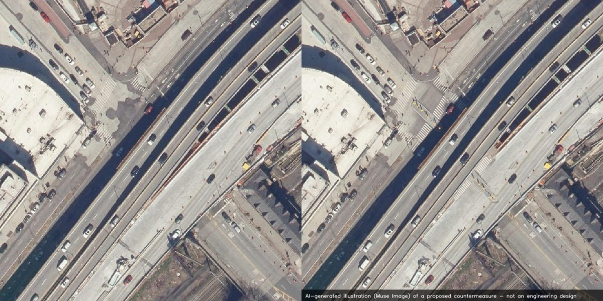
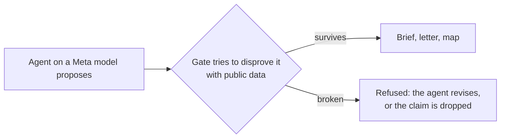
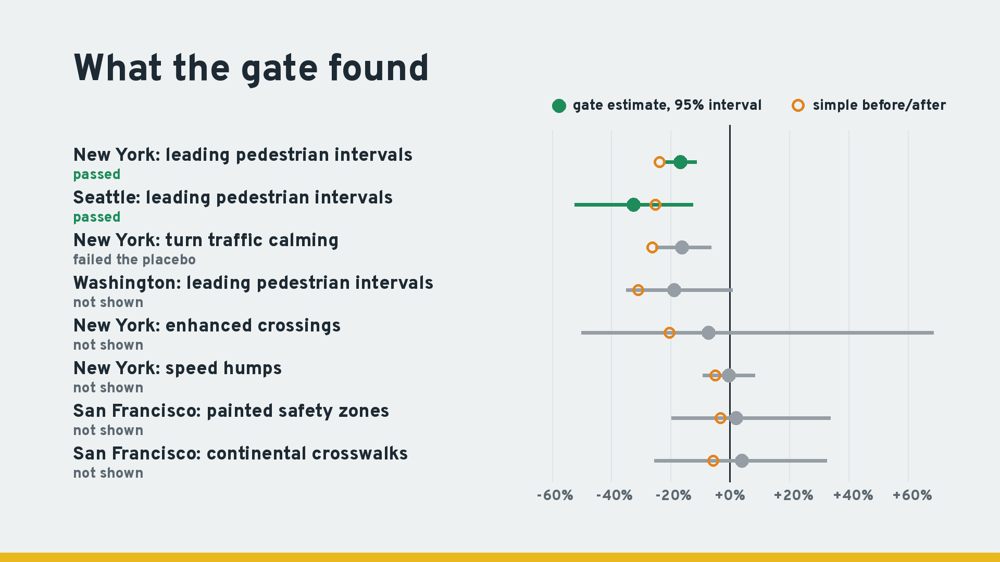

# NearMissLens

**A street-safety copilot whose every claim has to survive an attempt to disprove it.**


<sub>Bruckner Boulevard & Hunts Point Avenue, the Bronx. Left: New York State's aerial photo. Right: the copilot's top fix, pedestrian refuge islands, drawn by Muse Image. SAM 3.1 checked that islands were added and that no real car was moved. An AI illustration, not an engineering design.</sub>

In the last five years, Bruckner Boulevard & Hunts Point Avenue in the Bronx had 129 injury crashes, more than any other of New York's 304 Vision Zero priority intersections. 29 pedestrians were injured. In the U.S. DOT's official values that harm costs about $8.8 million a year. The city's open records show no safety work there since a 2015 street project, and no leading pedestrian interval.

NearMissLens found that in about a minute, from open records. It ranked the federal Proven Safety Countermeasures the record supports (pedestrian refuge islands first: about 1.6 fewer pedestrian injury crashes a year, worth $561,000 a year), drew the fix on the aerial photo, and drafted a letter to Council District 17 and Bronx Community Board 2 asking for a safety study. Each number in the brief and the letter was checked against the record before it was shown.

## Why the agents need gates

A city choosing a fix usually relies on national averages and rarely checks what its own past installs did. An AI analyst asked to check is not enough on its own: in our tests, Muse Spark Open writing its own analysis code missed New York's leading pedestrian interval effect, credited two programs the data does not support, and once reported an "increase" alongside a 15% drop.

NearMissLens builds on Meta's verifiable-agent pattern (the Agents 102 workshop), which puts the checks inside the tools so an agent cannot finish until its work passes them. Meta's checks compare claims with documents. NearMissLens adds checks for claims about the world: **a falsification gate** is a deterministic test, inside the tool an agent finishes with, that tries to show the claim is wrong. The claim goes through only if the test fails to break it.



| Claim | Gate |
|---|---|
| A number in a brief or letter | It must appear in the official record the agent was given |
| "This dataset is the city's crash data" | The adapter must return real records near a point in the city, with recent dates and numeric injury fields |
| "This fix works in this city" | **The causal gate:** the city's own past installs must show the effect against sites treated later, a fake install date before the real one must show nothing, and the design runs once on sites the agent never saw |
| "The drawing shows the fix" | SAM 3.1 must find the fix in the edited photo, with every real road user unchanged |

The causal gate is the new part. [`docs/METHOD.md`](docs/METHOD.md) explains it in full; the rules of every test were written in [`validation/BENCH_PREREG.md`](validation/BENCH_PREREG.md) before it ran (our own record, not an external registry), and every result, including the failures, is in [`validation/BENCH.md`](validation/BENCH.md).

## What the gates found



| Program | Simple before/after says | The causal gate says |
|---|---|---|
| New York leading pedestrian intervals, 1,651 intersections | pedestrian injury crashes −24% | **Passes: −17%** (95% interval −22% to −11%). A fake earlier date shows no change. The national figure the copilot ranks with is −19%. |
| New York turn traffic calming, 227 sites | −26% | **Fails.** Crashes had already fallen 22% in the 18 months before the work started. |
| Seattle leading pedestrian intervals, 371 intersections | −25% | **Passes: −33%** (−52% to −12%), the same design run unchanged in a second city. Both placebos show no change. |
| Washington DC leading pedestrian intervals, 267 intersections | −31% | **Not shown: −19%**, but the interval (−35% to +1%) includes no change. 600 of DC's sites had no later-treated comparison, so the test had little data; the gate says "not shown", not "doesn't work". |
| 200 fake programs in New York (random sites and dates, nothing installed) | credits 8.0% of them | credits 5.5% of them (95% interval 3.1–9.6%) |
| An AI analyst (Muse Spark Open) writing and running its own code, programs blinded | Without the gate: missed New York's LPIs, credited turn calming (−9%) and New York's speed humps (−11%), and called DC's LPIs an "increase" while reporting −15%; credited 2 of 20 fake programs | With the gate deciding on held-out sites: confirmed New York's and Seattle's LPIs and refused the other three. But it passed 5 of 20 fake programs, all with short designs (30 m, 12–24 months) the analyst chose itself |

**We tested the tester, and it has a weak spot.** Those 5 false passes led to a stricter, calibrated gate (T14, registered before it ran): a program must also beat 97.5% of 200 fake programs run through the same design. It cut false passes to 2–3% on 100 fresh fake programs, but it no longer confirms the LPIs: New York's effect ranks at the 13th percentile of fake programs (Seattle and DC have too few untreated hotspots to build a fair comparison). So the original gate stays, its intervals are optimistic, and the copilot shows each program's rank among fake programs next to its verdict. Read the LPI result as consistent evidence across two cities and three published studies, not as proof.

The same design also ran, unchanged, on four more programs. None passed, and the reasons differ. New York's enhanced crossings and San Francisco's painted safety zones had fewer than 100 usable sites, so their intervals are too wide to show anything (not shown). New York's speed humps (1,008 sites, all injury crashes: θ 0.996, 0.909–1.085) and San Francisco's continental crosswalks (780 sites: θ 1.04, 0.75–1.33) show no measurable change. In total: 7 programs in 4 cities, 2 passed, both of them leading pedestrian intervals.

Two of these results changed the product. The brief now shows a city's own measured effect next to the national CMF when a program passed the gate, and it never recommends a fix the city's records show is already installed. A screen of all 304 New York priority intersections found 119 with no leading pedestrian interval; at New York's measured effect, adding them would prevent about 43 pedestrian injury crashes a year (29–56). That last figure is a projection, not a test, and each site needs an engineer's check.

## What it does

`nml app` opens the copilot: a map of a city's priority intersections and a search box.

1. **The record.** Police-reported crashes within 100 m over five years (who was hurt, contributing factors), the city's designations and its recorded projects. For New York's 304 priority intersections: 11,474 injury crashes and 56 deaths, about **$786 million a year** in harm at the U.S. DOT's value of an injury crash ($342,400, [BCA Guidance 2026 Update](nearmisslens/data/usdot_bca.json)). 225 of them had at least 10 injury crashes and no recorded safety treatment in that time.
2. **Ranked, priced fixes.** Each FHWA Proven Safety Countermeasure whose CMF Clearinghouse record targets a crash group in the record, ranked by expected crashes avoided per year (Highway Safety Manual simple method), with the harm it avoids and the cost under which it pays for itself over 10 years at USDOT's 7% discount rate.
3. **What has worked here.** Every program in the city that has been through the causal gate, with its result or the reason it failed.
4. **The drawing.** Muse Image draws the top fix on the city's aerial photo; SAM 3.1 checks it.
5. **Receipts.** Each brief lists which gate verified which claim.
6. **A letter.** One click drafts a letter to the council member and community board for that corner (found from the city's district maps), with every number checked and the sources attached. NearMissLens sends nothing; the resident reviews and sends it.
7. **Near-misses from video**, where video exists. SAM 3.1 tracks every road user in drone video and the conflict engine measures time-to-collision and post-encroachment time (FHWA SSAM definitions), so hotspots show up before crashes do.

**The whole loop can run without a person wiring the city.** The program agent (`nml programs CITY`) searches the public catalogs for a city's dated safety programs, maps each one (install date, filter, FHWA countermeasure), and a validator inside its tool refuses mappings whose dates don't parse, are only years, or fall outside the city. Given only the city name, it found Seattle's leading pedestrian interval layer on its first try and turned down 39 other layers (bike counters, asset inventories, an Austin dataset); `nml gate seattle` then ran the causal gate on what it found: −33% on 366 intersections, passed, matching the hand-built study.

**Cities are data, not code.** Each dataset, district map and transport agency is an entry in [`registry.json`](nearmisslens/data/registry.json), and each study is a JSON file in [`validation/studies/`](validation/studies/). For a city it has never seen, the data agent (`nml discover LAT LON`) searches the public Socrata and ArcGIS catalogs and maps the fields; its validator refused two wrong mappings for Seattle before accepting a working adapter, for $0.03.

## Meta models

| Agent | Model | Job |
|---|---|---|
| Analyst | **Muse Spark Open** on Baseten | Writes and runs its own analysis code in a sandbox; its causal claims go through the gate |
| Brief writer, letter writer, data agent | Muse Spark (Meta API), **Muse Spark Open** (Baseten) or **Muse Glimmer** (Modal GPU) | Every number checked against the record |
| Tracker | SAM 3.1 (video and image) | Zero-shot tracking of every road user in drone video |
| Engineer | Muse Image + SAM 3.1 | Draws the fix on the aerial photo; SAM checks it and protects real road users |
| Intake | Muse Voice Transcribe + Muse Spark | Checks a resident's spoken complaint against the measured evidence |
| Review panel | Muse Spark, Muse Wonder | Proposer, skeptic and judge on countermeasures, with human sign-off |

The open-weights path covers the whole copilot: the web app's briefs and letters run on Muse Spark Open by default.

## Other results

From the same benchmark, each with its rules written down before it ran:

- **Near-misses from video** (11 unseen one-minute windows, 241 reference conflicts): better kinematics and re-seeding raised PET ≤ 1.5 s F1 from 0.23 to 0.36 and recall from 0.19 to 0.29. Agreement is with FLUID's reference trajectories, not ground truth, and pedestrians are not tracked from 120 m altitude.
- **Hotspots persist** across days at the same junction (Kendall tau 0.47 over 26 pairs, p = 0.001).
- **Residents' near-miss reports did not improve crash prediction** in Washington DC (held-out 30% of the city, future years; top-5% precision 0.586 with and without them).
- **The number checker matters:** city memos had 0 of 34 ungrounded claims with it and 4 of 34 without.
- **Complaint checking** (32 complaints): Muse Spark 100% at $0.0016 each, Muse Wonder 96.9%, Muse Glimmer 87.5%, Muse Spark Open 78%.

## Try it

```bash
uv sync                                         # Python 3.12
uv run nml app                                  # the copilot on http://127.0.0.1:8770
uv run nml brief "Bruckner Boulevard & Hunts Point Avenue, Bronx, NY" --letter
uv run nml treatments T11                       # rerun New York's LPI study and its gate
uv run nml discover 47.6097 -122.3331           # add a city with the data agent
uv run nml bench                                # rebuild validation/BENCH.md from stored results
uv run nml --replay selftest                    # offline self-test, no keys
```

Keys go in `.env`: `BASETEN_API_KEY` (Muse Spark Open), `MODEL_API_KEY` (Meta Model API), optionally `MAPILLARY_CLIENT_TOKEN`. Every paid call is cached and logged, `NML_BUDGET_USD` caps Meta spend, and `--replay` never calls an API. The replay cache (`nearmisslens_replay_cache.tar.gz` on the GitHub release) reruns everything without keys.

## Limits

- **A screening aid, not a design.** Estimates use the Highway Safety Manual's simple method, fixes must not be added together, and a qualified engineer must review every recommendation.
- **The causal gate is observational.** Cities pick their sites, so some regression to the mean can remain even with the placebo, and about 1 in 20 fake programs passed it. A passed gate is strong evidence, not proof.
- **"No recorded treatment" means none in the city's open datasets** within 60–150 m. Work recorded elsewhere is not seen.
- **Video agreement is partial**: about 3 in 10 reference conflicts are found on unseen footage.

## Built during the hackathon

Everything in this repository was written during the Meta Global AI Developer Hackathon (Oct 27 – Nov 4, 2026); the first commit is dated Oct 27. Data and model licences are in [`LICENSES.md`](LICENSES.md) (FLUID CC BY 4.0, Mapillary CC BY-SA, US public-domain imagery, city open-data terms); see also [`PRIVACY.md`](PRIVACY.md).
